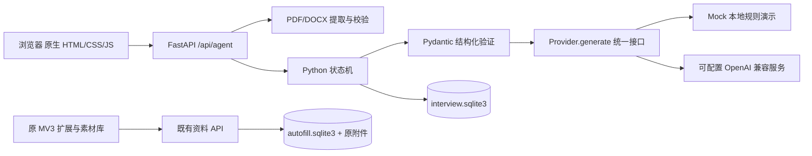
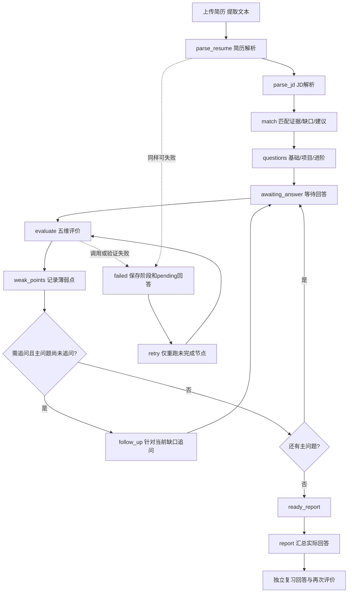

# 设计说明

## 1. 定位和边界

在既有求职素材库与浏览器扩展上新增单用户“简历分析与模拟面试 Agent”。Agent 是有状态、有校验、有用户参与的工作流，不是自主替用户投递的机器人。没有引入第二套前端框架或通用工作流引擎。

原扩展功能继续使用 `/api/profile`、`/api/resumes`、`/api/projects`、`/api/match`；面试使用独立 `/api/agent` 命名空间。既有资料库 `autofill.sqlite3` 不迁移、不清空。新记录写入同一资料目录下的 `interview.sqlite3`；上传原文件只在内存中提取，不额外保存原件。

## 2. 架构

## 3. 节点与恢复

- 每次节点开始与完成写入事件；页面轮询 GET 会话显示真实阶段。
- 解析成功节点保留，后续模型失败不会重建全部问题。失败响应是带 `status=failed` 和结构化 `error` 的会话，前端明确展示失败，不按 HTTP 200 误报成功。
- 用户回答先写入 `pending`，评分通过校验后将答案、评价、薄弱点、下一题一次性写入状态。最多 8 道主问题，每题最多一次追问，避免无限循环。
- 一个会话同时仅允许一个修改操作，SQLite `BEGIN IMMEDIATE` 领取操作租约；并发请求返回 409。
- 回答和复习含请求 UUID；同一个 UUID 与内容重发不会产生重复记录，换内容复用 UUID 返回 409。
- 单进程启动时恢复被中断的租约为明确失败；重试从保存节点继续。此设计**只支持一个 Uvicorn worker**，不应多副本共享同一 SQLite。
- 历史最近显示 100 条；原答案与复习答案分别保留。`reviewed` 只表示已复习，不代表掌握；报告原始评分不被复习分覆盖。

## 4. 模型边界与可信性

Provider 接口不依赖业务 API：`generate(task, payload, schema) -> BaseModel`。生产接口使用 httpx，API Key 为环境变量并在配置中以 `SecretStr` 保存。默认 `AGENT_PROVIDER=mock`，不根据是否缺少 Key 静默切换模式；真实模式缺 Key/模型名会显式启动失败。

真实模式使用 JSON Schema（或显式配置 JSON object 兼容模式），两者都经过 Pydantic 校验。HTTP 每次调用有超时，最多重试 3 次（默认额外重试 2 次）；仅暂时性网络/服务错误和结构错误重试，鉴权错误不重试。结构化日志仅记录节点、次数、耗时、错误类别和会话 ID，不记录简历、回答、密钥及模型响应正文。

提示词将简历/JD/回答视为不可信资料，拒绝其中改变规则或伪造分数的指令。经历与匹配输出保留原文 evidence，并进行证据定位检查。参考答案使用知识解释或真实经历回答框架，不把课程项目改成实习，不虚构成果；其内容仍需用户独立核实，提示词及证据定位不能保证所有模型语义无误。

“真实性”评分仅为叙述具体性、与提供材料的一致性，**不是背景调查或测谎**。不从低分推断用户不诚实；匹配分是文本证据覆盖，不是录取概率。

Mock 模式为确定性规则，适合离线演示、回归和故障测试。规则分段支持常见中英文标题，领域知识覆盖有限，评分是启发式，不能作为面试能力测量或真实 LLM 效果证明。

## 5. 文件、隐私与部署

- PDF/DOCX ≤12 MiB，最多80页PDF、60,000字符文本；检查后缀、内容签名及OOXML结构；DOCX限制内部文件数量与解压总量，拒绝宏、路径穿越和XML实体。扫描件/加密PDF给出明确提示，不伪称OCR成功。
- 校验在后台线程执行，不运行附件宏、不展开文件到磁盘。PDF解析不是沙箱子进程；极端恶意文件仍需外部资源隔离及网关上传限制。
- 默认仅 localhost。扩展保持原本本地模式，绝不最终提交申请。启用外部模型前需用户明确同意发送文本；建议上传前移除证件、联系方式等无关敏感信息。
- 远端 Host/Origin 必须配长随机 `APP_ACCESS_TOKEN`，所有私有新旧API都验证 `X-Agent-Token`。这是单操作者口令，不是多租户账户系统。不同使用者不能共享此部署存储私人简历。
- 容器以非 root 用户运行，只读应用目录，数据卷保存SQLite，支持健康检查。Compose默认仅绑定主机127.0.0.1。真正公网部署还须TLS反向代理、上传大小/速率限制、备份与访问控制，不能把内置开发服务直接暴露公网。
- `.env`、`.data`、简历文件、日志和虚拟环境不进源码包。删除会话会删除该会话，只有无其他会话引用的Agent上传文本才随之删除；原素材库始终不受影响。未建立会话的上传文本暂没有自动清理策略。

## 6. 验证和已知限制

验证分为提取与模型接口单元测试、状态存储/HTTP集成测试、原扩展回归及真实浏览器面试E2E。故障测试使用 HTTP 模拟传输与替换 Provider，覆盖超时、拒绝、无效结构、重试、并发和幂等。正常测试绝不读取真实资料库或付费模型。

当前没有语音面试、OCR、向量检索、自动抓JD、互联网事实核查、多人账户、后台队列和分布式执行。不会自动把解析出的事实改写进原简历或投递表单。

本轮没有真实模型 Key，因此真实模型服务的计费、特定模型兼容性与评分质量未实测；没有 Docker 运行时的环境只能检查部署配置，容器构建应由部署者或CI验证。兼容服务需支持 Chat Completions、JSON结构化输出及 `max_completion_tokens`；不支持时应修改独立Provider适配而非绕过校验。

## 7. 后续可验证的改进

1. 建立人工标注题库与评分一致性评估，验证真实模型输出质量。
2. 增加结构化简历人工修订及证据高亮，减少非标准简历误提取。
3. 引入独立提取进程、上传文本保留策略和显式数据导出/删除管理。
4. 有多人部署需求时再加入登录、会话所有权、任务队列和PostgreSQL，不提前引入复杂依赖。

## 文档依据

真实Provider的结构化输出格式按 [OpenAI Structured Outputs 文档](https://developers.openai.com/api/docs/guides/structured-outputs?api-mode=chat) 和 [Chat Completions API](https://developers.openai.com/api/reference/resources/chat/subresources/completions/methods/create) 实现；本项目不限定必须使用某一家模型服务。
